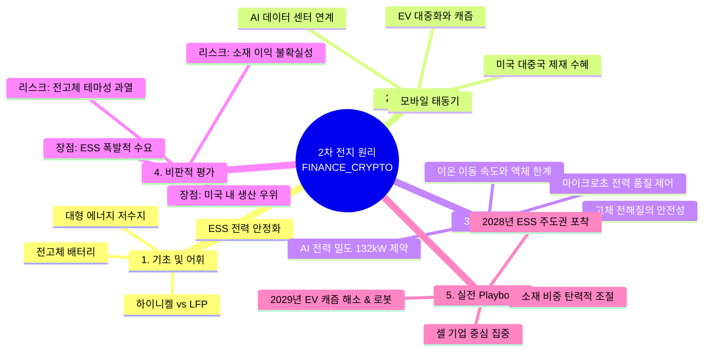

# [2차 전지의 원리] 전방위 제1원리 지식 마스터 리포트

## 0. Executive Core Insight (본질 관통 핵심 요약)
> **"2차 전지의 본질은 단순한 에너지 저장 장치를 넘어, AI 데이터 센터의 급격한 전력 부하 변동성을 통제하는 '초정밀 전력 품질 제어 인프라'이자, 지정학적 공급망 재편 속에서 주도권을 다투는 '국가 전략 자산'이다."**

---

## 1. Ground Zero: Foundational Axioms & Key Lexicon (기초, 기반, 핵심 어휘 사전)

*   **일상 비유:** 2차 전지는 **'여러 번 리필해서 쓸 수 있는 초대형 에너지 저수지'**입니다. 전기차(EV)에 들어가면 자동차를 움직이는 연료탱크가 되고, AI 데이터 센터에 들어가면 폭우처럼 쏟아지는 전력 수요의 급류를 막아주는 댐 역할을 합니다.
*   **핵심 필수 키워드 3~5선:**
    1.  **ESS (Energy Storage System):** 에너지를 저장했다가 필요할 때 공급하는 장치. 최근 클라우드 중심에서 전력 변동성이 극심한 **AI 데이터 센터용(Greenfield)** 전력 품질 안정화의 핵심 구원투수로 부상.
    2.  **하이니켈 (High-Nickel) 양극재:** '바닥만 있는 건물'처럼 이온(사람)이 많이 들어가 에너지 밀도(주행거리)는 극대화되나, 구조적 불안정성(화재 위험)이 존재하는 고성능 소재.
    3.  **LFP (Lithium Iron Phosphate):** '기둥과 바닥이 탄탄한 건물'처럼 구조적 안정성은 높지만 공간이 좁아 에너지 밀도가 낮은 보급형 소재. 미국 시장의 중국 제재(FEOC 등) 반사이익 수혜 영역.
    4.  **전고체 배터리 (All-Solid-State Battery):** 액체 전해질을 고체로 대체하여 불순물 발생 및 발화 위험을 원천 차단하고 에너지 밀도를 극대화하는 궁극의 차세대 배터리 (삼성SDI, 이수스페셜티케미컬 주도).

---

## 2. Historical Trajectory & Paradigm Shifts (역사적 배경, 변천 궤적, 현재 위치)

```
[Phase 1: IT 모바일 중심] ➔ [Phase 2: EV(전기차) 캐즘 대중화 시도] ➔ [Phase 3: AI 데이터 센터 & ESS 중심의 구조적 대전환 (현재)]
```

*   **과거의 출현 배경:** 초기 2차 전지는 스마트폰, 노트북 등 소형 IT 기기의 휴대용 전원 공급원으로 출발했습니다. 이후 탄소중립 패러다임과 함께 전기차(EV) 시장의 폭발적 성장을 견인하며 전통 제조업의 핵심으로 자리 잡았습니다.
*   **패러다임 전환 궤적:** 전기차 대중화 과정에서 수요 정체(캐즘)와 화재 안전성 문제, 중국의 저가 공세라는 구조적 한계에 부딪혔습니다. 그러나 2026년 현재, 패러다임은 **'AI 데이터 센터의 급증하는 전력 품질 제어 및 ESS 수요'**로 완전히 이동했습니다.
*   **현재 시점의 구조적 좌표:** EV 중심의 성장 신화가 숨 고르기에 들어간 반면, 미국 중심의 대중국 제재(FEOC 규정)와 AI 인프라 투자 붐이 맞물려 **'셀(Cell) 기업 중심의 프리미엄 및 ESS 수혜 국면'**이라는 새로운 국면에 진입해 있습니다.

---

## 3. First Principles & Structural Mechanism (기저 메커니즘과 진짜 제약)

*   **물리적 인과관계 본질:**
    *   **액체 전해질:** 이온 이동 속도가 빨라 고출력에 유리하나, CO2 및 불순물 결합으로 인한 발화 위험(Thermal Runaway)이라는 지울 수 없는 물리적 제약을 지닙니다.
    *   **고체 전해질 (전고체):** 이온이 고체 도로를 걸어 다니듯 이동하여 속도는 다소 느리지만, 불순물 생성을 차단해 하이니켈과 같은 고에너지 밀도 양극재를 안전하게 적용할 수 있습니다.
*   **진짜 제약 vs 가짜 제약 해체:**
    *   *가짜 제약:* "모든 2차 전지 주는 EV 판매량에 종속되어 함께 죽고 산다." (X)
    *   *진짜 제약:* AI 데이터 센터의 랙당 전력 밀도가 루빈 울트라 기준 132kW까지 폭증함에 따라 발생하는 **'초 단위 전력 품질(Micro-second Power Quality) 제어 능력'**이 배터리 채택의 실질적 병목(Bottleneck)입니다. 커패시터만으로는 감당할 수 없는 이 공백을 배터리 기반 ESS가 필수적으로 메워야 합니다.

---

## 4. Critical Dialectics: Pros, Cons & Counter-arguments (비판적 사고: 명과 암, 맹점과 반론)

*   **핵심 효용 및 기회 (Pros):**
    *   AI 데이터 센터 그린필드 건설 시 배터리 탑재 비중이 50% 이상으로 급증하며 새로운 거대 수요처 확보.
    *   미국의 강력한 대중국 공급망 제재(FEOC)로 인해 한국 3사 및 관련 밸류체인의 수혜 가시화.
*   **구조적 취약점과 리스크 (Cons):**
    *   소재(특히 양극재) 기업들의 경우, 셀 기업의 단가 압박과 불확실한 이익률로 인해 주가 반등의 시차가 길어질 수 있음.
    *   전고체 배터리는 여전히 상용화 초기 단계로, 테마성 변동성에 노출될 위험 상존.
*   **유효한 반론 (Counter-arguments):**
    *   *반론:* "유럽의 탄소 규제 완화나 저가 배터리 선호 현상으로 인해 한국 기업의 입지가 좁아지는 것 아니냐?"
    *   *방어선:* 중국 CATL 등의 유럽 내 공장 램프업(생산량 확대) 속도가 더디고, 미국 시장 내 안보적 진입 장벽이 공고하므로 기술력을 갖춘 선두 셀 기업들의 헤게모니는 유지됩니다.

---

## 5. Master Playbook: Real-world Applications & Future Scenarios (실전 활용과 미래 전망)

*   **현업 10배 레버리지 실행 규율:**
    1.  *밸류체인 차별화 접근:* 실적과 수주 가시성이 높은 **'셀(Cell) 대형주 및 AI ESS 연계 냉각 시스템'** 중심의 포트폴리오 재편.
    2.  *소재 섹터 유연화:* 양극재 등 물려 있는 소재 비중은 포트폴리오 다변화(실적 장세가 뚜렷한 IT 등과의 분산)를 통해 기회비용 관리.
    3.  *차세대 기술 선별:* 전고체는 테마적 접근을 경계하되, 2026년 말~2027년 양산 가시화 시점(삼성SDI 등)에 맞춰 타이밍 포착.
*   **2차·3차 파급 효과와 변곡점 시나리오 (2028~2029년):**
    *   **2028년:** AI 데이터 센터용 ESS가 2차 전지 성장의 메인 엔진으로 완전히 자리매김.
    *   **2029년:** EV 보조금 의존도가 낮아지며 캐즘이 해소되고, 46시리즈 중심의 롱레인지 프리미엄 시장 활성화. 로봇용 배터리가 차세대 모멘텀(매출 비중 1~2% 내외)으로 가시화.

---

## 6. Visual Mindmap & Structural Hierarchy (시각화 구조)

### (A) XMind / Outliner Compatible Tree
- 2차 전지의 원리
	- 1. 기초 공리 및 핵심 개념
		- 에너지 저수지로서의 본질 (EV 및 ESS)
		- 핵심 키워드: ESS, 하이니켈, LFP, 전고체
	- 2. 역사적 변천과 현재 위치
		- 모바일 ➔ EV 캐즘 ➔ AI 데이터 센터 인프라 전환
		- 미국 대중국 제재(FEOC) 기반 수혜 국면
	- 3. 기저 메커니즘 & 진짜 제약
		- 액체 vs 전고체 물리적 인과관계
		- AI 데이터 센터 전력 품질(Micro-second) 제어 제약
	- 4. 비판적 평가 (Pros & Cons)
		- 장점: AI ESS 수요 폭발, 미국 공급망 반사이익
		- 리스크: 소재 단가 압박, 전고체 테마성 변동성
	- 5. 실전 실행 및 미래 전망
		- 셀 중심 포트폴리오 압축 및 다변화
		- 2029년 EV 캐즘 해소 및 로봇 모멘텀 진입

### (B) Mermaid Mindmap Code Block
