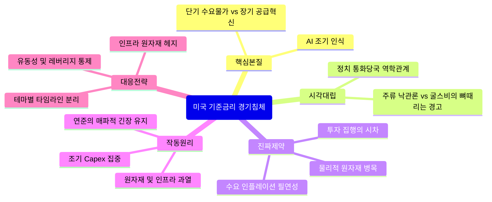

# [FINANCE_CRYPTO_MARKETS] 미국 기준금리 경기침체: 다각도 교차 검증 & 제1원리 심층 리포트
> topic: "미국 기준금리 경기침체" | domain: "FINANCE_CRYPTO_MARKETS" | sources_count: 1 | mode: "Autonomous Multi-Perspective Synthesis"

## 0. Executive Core Insight (다각도 종합 핵심 통찰)
- 인공지능(AI)과 신기술로 인한 생산성 혁신은 장기적으로 구조적 저물가(공급 혁신)를 이끌어낼 잠재력이 있으나, 과거 닷컴 버블 시기와 달리 **‘변화의 가치를 너무 일찍 인지한 시장’**으로 인해 단기 설비 투자가 폭발적으로 집중되면서 오히려 원자재·병목 현상을 동반한 **‘수요 주도형 물가 압력’**을 선제적으로 촉발하고 있다. 이로 인해 연준(Fed)의 기준금리 경로와 경기 침체 프레임은 단순한 '긴축 대 완화'의 이분법을 넘어, 설비 투자의 시차와 물가 반등 압력을 통제해야 하는 국면으로 진입했다.

## 1. Clash of Perspectives (쏟아지는 다양한 시각의 대립과 모순)
- **주류/낙관적 시각 (장기 침체 종말론 및 AI 공급 혁신론):** 
  - *핵심 주장:* 글로벌 저축 과잉 구조가 투자 급증 시대로 전환되었으며, AI 등 혁신 기술이 궁극적으로 엄청난 공급 능력을 확충해 장기적 저물가와 고성장을 동시에 담보할 것이라는 시각입니다.
  - *평가:* 장기적 방향성 면에서는 타당하나, 전환 과정에서의 시차와 비용 구조를 과소평가하고 있습니다.
- **비판적 현장 분석 시각 (시카고 연은 굴스비 및 전문가들의 뼈 깎는 경고):**
  - *핵심 주장:* 1990년대 닷컴 버블 당시에는 인터넷의 생산성 혁신을 뒤늦게 깨달아 완만하게 투자가 늘었으나, 현재는 모든 경제 주체가 AI의 가치를 너무 일찍 깨달아 투자가 단기에 과도하게 집중되고 있다는 점을 지적합니다.
  - *평가:* 팩트에 기반한 날카로운 지적으로, 단기 수요 폭발과 원자재(구리 등) 병목 현상이 인플레이션을 자극해 연준의 금리 인상 압박을 재소환할 수 있다는 점을 정확히 짚어냈습니다.
- **정치·통화당국 역학 관계 시각 (트럼프 행정부와 연준 수장의 줄다리기):**
  - *핵심 주장:* 연준 의장 및 주요 인사들의 발언(FMC 코멘트 등)이 단순한 정치적 허수아비가 아니라, 인플레이션 통제 의지와 현실적 경기 방어 사이에서 끊임없이 독자적 색깔과 모순을 드러내고 있다는 분석입니다.

## 2. Real Constraints vs Fake Constraints (진짜 제약 vs 가짜 제약 해체)
- [가짜 제약]: 
  - "AI 기술은 무조건적이고 즉각적인 저물가를 가져올 것이다"라는 단순 선례 (과거 닷컴 버블의 전개 양상을 그대로 답습할 것이라는 기계적 사고).
  - 연준의 기준금리가 단 한 방향(무조건적 인하)으로만 흐를 것이라는 대중의 관습적 기대.
- [진짜 제약]: 
  - **물리적·자원적 병목 현상:** AI 데이터 센터 구축, 전력 인프라, 구리 등 핵심 원자재 수요가 단기간에 집중되면서 발생하는 물리적 공급망 한계.
  - **자본 이동 및 투자 집행의 시차(Time-lag):** 장기적 공급 혁신 효과가 나타나기 *이전*에 단기적으로 투자가 촉발하는 '수요 인플레이션'의 수학적 필연성.
  - **정책적 딜레마:** 물가 재발 위험(단기)과 경기 침체 방어(통화 완화) 사이에서 연준이 직면한 제도적·통계적 제약.

## 3. Underlying Mechanics & Feedback Loops (기저 인과관계 및 작동 메커니즘)
1. **인식의 가속화:** 경제 주체들이 AI 혁신의 가치를 조기에 학습함 $\rightarrow$ 설비 투자(Capex) 집행 속도가 과거 역사적 주기보다 훨씬 압축되고 급격하게 진행됨.
2. **단기 수요 집중과 원자재 압박:** 데이터 센터, 관련 하드웨어, 인프라 구축에 막대한 자본이 단기 집중됨 $\rightarrow$ 구리, 전력 등 실물 자원 가격 상승 및 공급망 병목 발생.
3. **물가 반등 및 연준의 반응:** 생산성 향상(공급 혁신)이 본격화되기 전, 단기 설비 투자 발(發) 수요 인플레이션이 수치로 가시화됨 $\rightarrow$ 연준이 시장의 금리 인하 기대와 달리 매파적 스탠스를 재조정하거나 긴장을 유지함.
4. **시장 변동성 확대:** "금리 인하 기조"와 "물가 재발 우려"가 충돌하며 주식 및 크립토 시장의 국지적 조정과 섹터별 순환매 발생.

## 4. Second & Third-Order Ramifications (3~6개월 뒤 연쇄 반응)
- **3개월 후:** AI 인프라 관련 실물 원자재 및 에너지 섹터의 가격 변동성 급증. 연준의 FOMC 회의록에서 '인플레이션 경계감'이 예상보다 매파적으로 해석되며 자산 시장의 단기 노이즈(조정) 유발.
- **6개월 후:** 단기 설비 투자 피로도가 누적되는 동시에, 생산성 향상 효과가 일부 섹터의 마진 개선으로 가시화. 통화 당국은 경기 침체 방어와 인플레이션 통제 사이에서 정교한 밸런싱을 강제당하며, 매크로 지표에 연동된 극단적 종목 차별화 장세 전개.

## 5. 10x Actionable Playbook (실전 대응 전략)
1. **단기 물가 압력에 대한 헤지:** 구리, 전력 인프라, 원자재 관련 실물 자산 및 연관 섹터의 비중을 포트폴리오의 안전판으로 유지하십시오.
2. **AI 테마의 이원화 접근:** '데이터 센터 구축 및 인프라' 단계(단기 수요 주도)와 '소프트웨어 및 생산성 실현' 단계(장기 공급 주도)를 구분하여 타임라인별로 종목을 필터링하십시오.
3. **연준 스탠스 노이즈 무시:** 금리 인하 시점에 대한 시장의 일희일비에 흔들리지 말고, 실물 경제의 Capex 집행 속도와 병목 지표를 기준으로 매크로 리스크를 측정하십시오.
4. **유동성 리스크 관리:** 크립토 및 고위험 자산 시장에서 단기 금리 변동성에 따른 급격한 레버리지 청산에 대비해 현금성 자산 비중을 일정 수준 확보하십시오.
5. **생산성 수혜 기업 선별:** 단순한 기대감이 아니라, AI 도입으로 *실제 비용 구조가 개선되고 마진이 확대되는 기업*에 집중하십시오.

## 6. Structural Mindmap (통합 구조도)
