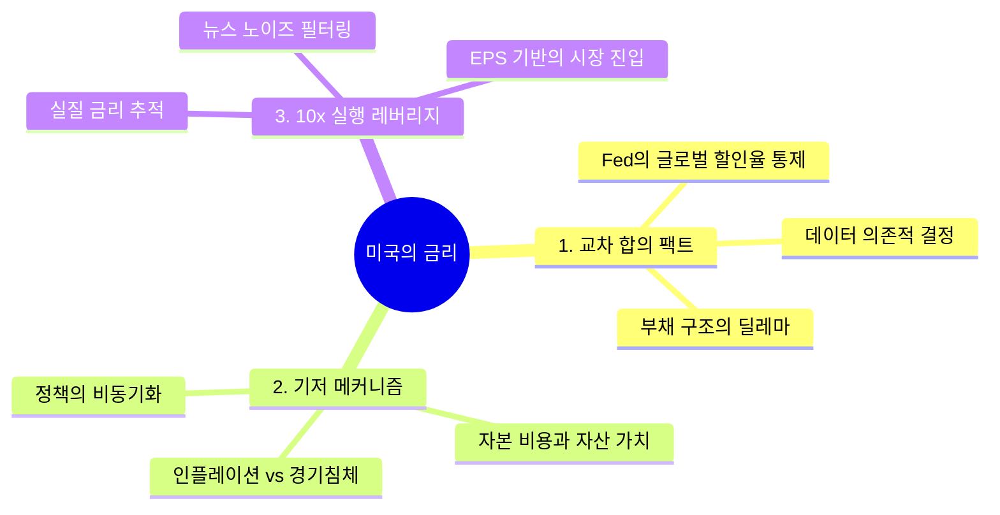

제1원리 기반 지식 아키텍트로서, 제공해주신 [FINANCE_CRYPTO_MARKETS] 도메인 내 미국의 금리 이슈를 분석합니다.

---

## 0. Executive Core Summary
**금리 인하는 유동성 공급의 신호인 동시에 경제 시스템의 '체력 저하'를 방증하는 경고등이므로, 단순한 자산 상승 기대를 넘어 경기 침체와의 상관관계를 우선적으로 상쇄해야 한다.**

---

## 1. Cross-Source Consensus & Divergence
*   **Consensus Ground Truth (합의된 사실):** 
    *   미국 연준(Fed)의 통화정책은 글로벌 금융 시장의 유동성을 결정짓는 최상위 지표임.
    *   물가 안정과 고용 데이터가 금리 결정의 핵심 변수(Data-dependent).
    *   금리 인하는 가계 부채 및 부동산 시장 등 국내 자산 시장에 즉각적인 레버리지 압력으로 작용함.
*   **Divergence (괴리 및 상충):**
    *   **영상(뉴스):** 9월 인하를 '확실시'하며 자산 시장 활성화와 경기 침체 가능성 사이의 '심리적 딜레마'에 집중함.
    *   **웹(데이터):** 통계 모델과 경제 지표를 기반으로 2026-2028년까지의 완만한 금리 경로를 제시하며, 시장의 과도한 기대를 차단함.
    *   **편향:** 영상은 대중의 투자 심리에 기반한 '변동성'을 강조하는 반면, 웹은 수학적 모델에 기반한 '평균 회귀'를 지향함.

---

## 2. First Principles & Structural Mechanism
*   **기저 원리(The Mechanism):** 
    *   **화폐의 가격(금리):** 자본의 기회비용. 금리 인하는 자본 조달 비용 하락 → 유동성 공급 증가 → 위험 자산(Crypto/Stock)의 할인율 감소(가치 상승).
    *   **인과관계(Pivot):** 인플레이션 하락(목표 달성) → 금리 인하 → 경기 침체 방어. 하지만 역설적으로 금리 인하가 '경기 침체의 신호탄'으로 해석될 경우, 자산 시장은 안전자산 선호로 역행함.
*   **엄격한 분리:** 
    *   **가짜 제약:** "언론의 9월 인하 뉴스에 따른 당장 내일의 급등/급락" (심리적 반응).
    *   **진짜 제약:** "기축통화 발행국인 미국의 실질 금리 vs 잠재성장률의 격차" (물리적/수학적 강제성).

---

## 3. Bottlenecks & Critical Trade-offs
*   **병목 (Rate-limiting step):** 
    *   **부채의 경직성:** 가계 부채(특히 부동산 담보)가 높은 국가는 금리를 내리고 싶어도 금융 안정성을 위해 내리지 못하는 '정책적 포박' 상태에 빠짐.
*   **상충관계 (Trade-off):** 
    *   **유동성 vs 경기 안정:** 금리를 내려 유동성을 공급하면 자산 가격은 오르지만, 인플레이션이 재발하거나 경기 침체(Hard Landing)가 확정될 경우 자산 시장은 붕괴함. 

---

## 4. 10x Optimization Playbook
*   **최소 실행 경로:** 
    *   **뉴스 소비 중단:** 헤드라인에 반응하지 말고 '실질 금리(Nominal Rate - CPI)' 추이만 추적.
    *   **침체 데이터 필터링:** 실업률 데이터가 급증하는 시점의 금리 인하는 '호재'가 아닌 '매도 신호'로 재설정.
*   **실천 규율:** 
    *   금리 인하 초기에 자산에 진입하기보다, **'금리 인하가 시작된 후 기업 이익(EPS)이 꺾이지 않는 구간'**을 포착할 것.

---

## 5. Visual Mindmap & Structural Hierarchy

### (A) XMind / Outliner Compatible Tree
- 미국의 금리
	- 1. 교차 합의 팩트
		- 연준의 정책이 전 세계 자산 가격의 할인율 결정
		- 물가(CPI)와 고용 데이터에 종속된 정책 결정 구조
		- 금리 인하가 가계 부채 및 국가 경제 정책에 주는 딜레마
	- 2. 기저 메커니즘 및 제약
		- 금리=자본 비용, 하락 시 자산 가치 상승의 수학적 필연성
		- 금리 인하가 동반하는 '경기 침체'라는 구조적 리스크
		- 부채의 경직성으로 인한 국가별 통화 정책의 비동기화
	- 3. 10x 실행 레버리지
		- 데이터 의존적 추적(실질 금리 vs EPS 변동성)
		- 감정적 뉴스 노이즈의 제거 및 필터링
		- 경기 침체 신호와 금리 인하 시점의 상관계수 활용

### (B) Mermaid Mindmap Code Block
