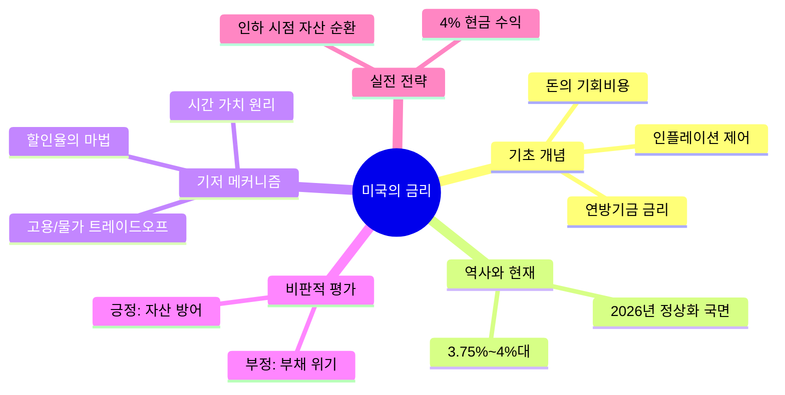

# [미국의 금리] 전방위 제1원리 지식 마스터 리포트

## 0. Executive Core Insight
**"미국의 금리는 세계 자본의 흐름을 결정짓는 '중력의 강도'이며, 이는 단순히 통화의 가격이 아니라 전 지구적 자산 배분과 위험 선호도를 규정하는 시간의 기회비용입니다."**

---

## 1. Ground Zero: Foundational Axioms & Key Lexicon
**[입문자를 위한 비유]**
금리는 **'돈의 월세'**입니다. 내가 가진 돈을 빌려줄 때 받는 대가이자, 은행에서 돈을 빌릴 때 내야 하는 비용이죠. 미국 금리가 오르면 전 세계의 돈은 이자를 더 많이 주는 '미국'이라는 거대한 저금통으로 빨려 들어갑니다. 마치 태양(미국 금리)의 중력이 강해지면 주변 행성(신흥국/코인 등)의 물건들이 궤도를 이탈해 태양으로 끌려가는 것과 같습니다.

**[핵심 키워드]**
1. **연방기금 금리 (Fed Funds Rate):** 은행끼리 하룻밤 빌릴 때의 금리. '돈의 원가'를 결정하며, 세상 모든 금융 상품 금리의 기준점이 됨.
2. **25bp (Basis Point):** 0.01%포인트를 의미. 시장은 0.25%p를 '1단계 속도 변화'로 인식함.
3. **인플레이션 위험 (Inflation Risk):** 돈의 가치가 하락하는 속도. 금리는 이 속도를 늦추기 위한 '브레이크' 역할임.
4. **완전 고용 (Full Employment):** 경제의 체력 지표. 일할 사람이 거의 다 일하고 있다면, 임금 상승 → 물가 상승(인플레)으로 이어지므로 금리를 올려야 하는 근거가 됨.

---

## 2. Historical Trajectory & Paradigm Shifts
- **과거의 배경:** 1980년대 20% 금리는 물가를 잡기 위한 '충격 요법'이었으며, 2008년 0.25%는 시스템 붕괴를 막기 위한 '생명 연장 장치'였습니다.
- **현재의 좌표 (2026년):** 3.75%~4.00%의 금리는 과거 20년간의 초저금리 시대(Zero Interest Rate Policy)가 끝나고 **'정상화된 비용의 시대'**로 진입했음을 의미합니다. 이제는 '공짜 돈'이 존재하지 않는 시장 환경입니다.

---

## 3. First Principles & Structural Mechanism
- **본질:** 금리는 **'시간 가치'의 역수**입니다. 금리가 높다는 것은 현재의 1달러가 미래의 1달러보다 훨씬 가치 있다는 뜻입니다.
- **진짜 제약:** 연준은 두 가지를 동시에 잡을 수 없습니다(Trilemma). **[물가 안정 vs 경기 부양]**. 노동 시장이 견고할수록 인플레를 잡기 위한 금리 인상의 명분은 강해집니다.
- **Ground Truth:** 금리가 오르면 모든 자산(부동산, 주식, 암호화폐)의 '현재 가치(NPV)'는 수학적으로 낮아집니다. 할인율(금리)이 분모에 있기 때문입니다.

---

## 4. Critical Dialectics: Pros, Cons & Counter-arguments
- **긍정적 레버리지:** 과열된 자산 버블을 억제하고, 화폐 가치를 방어하여 경제의 '질적 성장'을 도모함.
- **치명적 부작용:** 부채 비중이 높은 기업과 국가의 파산 위험 증가. '좀비 기업'의 연쇄 도산.
- **반론(확증 편향 해체):** "금리를 올리면 무조건 경기가 망한다?" → 틀렸습니다. 기술 혁신에 의한 생산성 향상이 금리 부담을 상쇄한다면, 고금리 시대에도 경제는 성장할 수 있습니다.

---

## 5. Master Playbook: Real-world Applications
- **전략 (10x Leverage):**
    1. **Cash is Option:** 4%대 금리는 그 자체로 연 4%의 무위험 수익률입니다. 무리한 투자를 지양하고 현금 흐름을 확보하세요.
    2. **Asset Allocation:** 금리 인하가 시작될 때까지 '현금 → 단기 채권 → 우량 성장주 → 비트코인' 순으로 자산 이동(Rotation)을 계획하십시오.
- **미래 전망:** 2027년까지 4%대 금리가 고착화된다면, 낮은 생산성을 가진 기업들은 도태되고, AI 등 생산성을 획기적으로 올리는 섹터에만 자본이 몰리는 **'부의 양극화'**가 가속화될 것입니다.

---

## 6. Visual Mindmap
### (A) XMind / Outliner Compatible Tree
- 미국의 금리
	- 1. 기초 공리 및 핵심 개념
		- 연방기금 금리 (기준점)
		- bp(Basis Point) 단위
		- 돈의 기회비용
	- 2. 역사적 변천과 현재 위치
		- 1980년대 고금리 vs 2008년 제로금리
		- 2026년 정상화 단계 (3.75~4%)
	- 3. 기저 메커니즘 & 진짜 제약
		- 할인율과 자산가치의 역관계
		- 물가와 고용 사이의 제로섬 게임
	- 4. 비판적 평가 (Pros & Cons)
		- 자산 거품 억제 vs 부채 이자 부담
	- 5. 실전 실행 및 미래 전망
		- 4% 무위험 수익률 활용
		- 금리 인하 시점 자산 배분 전략

### (B) Mermaid Mindmap Code Block
