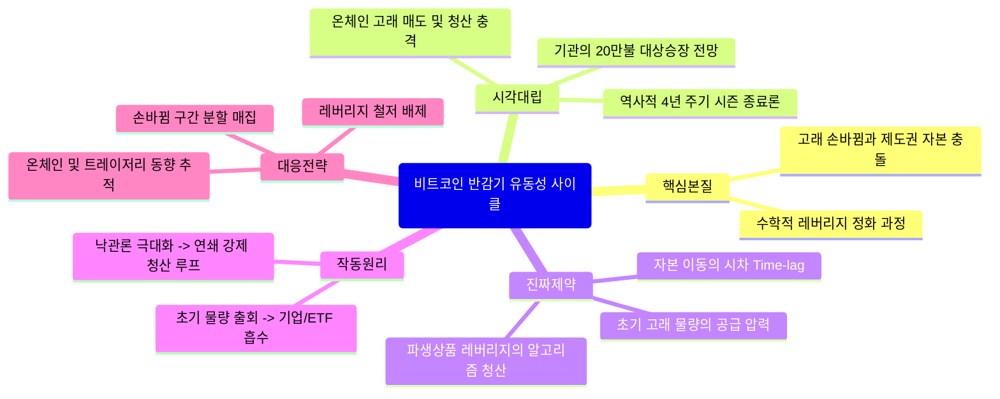

# [FINANCE_CRYPTO_MARKETS] 비트코인 반감기 유동성 사이클: 다각도 교차 검증 & 제1원리 심층 리포트
> topic: "비트코인 반감기 유동성 사이클" | domain: "FINANCE_CRYPTO_MARKETS" | sources_count: 2 | mode: "Autonomous Multi-Perspective Synthesis"

## 0. Executive Core Insight (다각도 종합 핵심 통찰)
비트코인 시장은 과거 ‘4년 주기 반감기 법칙’이라는 단순한 시계열 반복에서 벗어나, 초기 온체인 고래들의 물량 손바뀜과 기업형 재무 자산(Treasury) 및 ETF 등 제도권 자본의 유입 속도가 충돌하는 구조적 과도기에 직면해 있습니다. 2026년 현재의 조정 국면은 단순한 거시경제적 비관론이나 막연한 공포의 결과가 아니라, 블록체인 역사상 가장 거대한 규모의 장기 보유 물량 청산 및 레버리지 거품 해소가 맞물린 수학적·자본 이동적 필연의 과정입니다.

---

## 1. Clash of Perspectives (쏟아지는 다양한 시각의 대립과 모순)
- **주류/기관의 예측 (2025년 대상승장론):** 바네크, 비트와이즈 등 주요 기관들은 반감기 사이클, 금리 인하 국면, 친크립토 행정부의 등장이라는 외형적 유동성 호재를 근거로 20만 불 이상의 고점을 전망했으나 결과적으로 큰 오차를 보였습니다.
- **현장 분석가 및 온체인 데이터 시각:** 2025년 4분기 역대급 청산(약 190억 달러)의 본질은 낙관론에 취한 레버리지 과열뿐만 아니라, 7~10년 이상 비트를 보유해 온 초기 ‘고대 고래’들의 대규모 차익실현 및 원가 재설정(손바뀜) 과정에서 발생한 충격으로 진단합니다.
- **역사적 순환론적 시각:** 2014년, 2018년, 2021-2022년 모두 연말(11~12월)을 기점으로 3년 상승 후 1년의 혹독한 하락(시즌 종료)이 반복되었다는 100% 적중률의 과거 패턴을 근거로 2026년 역시 구조적 조정 압박이 불가피하다고 봅니다.

---

## 2. Real Constraints vs Fake Constraints (진짜 제약 vs 가짜 제약 해체)
- **[가짜 제약]:** 
  - "반감기 직후 무조건 폭등한다"는 관습적 선례와 단순 4년 주기 달력 시각.
  - 언론 보도와 일시적 거시 악재에 따른 대중적 공포 심리.
- **[진짜 제약]:** 
  - **자본 이동의 시차(Time-lag):** 초기 고래들의 수만 개 단위 매도 물량을 신규 기업형 재무 자산(MicroStrategy, Metaplanet 등)과 ETF가 소화하는 과정에서 발생하는 수급의 일시적 불균형 및 가격 정체.
  - **레버리지 한계 및 알고리즘 연쇄 청산:** 시장이 고점에 근접할수록 누적되는 과도한 파생상품 레버리지가 작은 트리거에도 시스템 전체를 무너뜨리는 유동성 물리 법칙.

---

## 3. Underlying Mechanics & Feedback Loops (기저 인과관계 및 작동 메커니즘)
1. **고래의 손바뀜 메커니즘:** 극초기 진입한 7년+ 고래들의 차익 실현 물량이 시장에 공급 $\rightarrow$ 기업형 트레이저리 및 ETF의 매수세가 하방을 방어하며 단계적 상승 유도.
2. **레버리지 과열과 연쇄 청산 루프:** 박스권 상단 및 상징적 가격대(예: 10만 불)에서 낙관론이 극에 달할 때 과도한 파생 레버리지 형성 $\rightarrow$ 미세한 매도 압력이나 거시적 충격 발생 $\rightarrow$ 역대급 규모(190억 달러 등)의 마진 강제 청산 $\rightarrow$ 현물 매도 연동 및 알고리즘 패닉 셀 유발.

---

## 4. Second & Third-Order Ramifications (3~6개월 뒤 연쇄 반응 시나리오)
- **2차 반응:** 기관 중심의 평균 취득 단가(Cost Basis)가 재조정되면서, 투기적 개인 자금이 이탈하고 기관 투자가 주도하는 견고한 하방 지지선 형성.
- **3차 반응:** 변동성이 극도로 압축된 이후, 레버리지가 완전히 정화된 상태에서 규제 명확성과 거시 유동성(금리 정책 등)의 재조율이 맞물려 새로운 형태의 펀더멘털 기반 수급 장세 진입.

---

## 5. 10x Actionable Playbook (실전 대응 전략)
1. **레버리지 전면 배제:** 단기 등락에 베팅하는 파생상품 및 과도한 차입 투자를 즉각 중단하고 현물 중심의 포트폴리오 재편.
2. **손바뀜 국면의 분할 매집:** 고래들의 물량 출회와 연쇄 청산으로 인한 공포 구간을 역이용하여, 장기 기관 수급이 유입되는 가격대에서 분할 적립식 매수 실행.
3. **온체인 지표 모니터링:** 핫월렛/콜월렛 간 자금 이동 및 장기 보유자(LTH)의 솝바뀜 지표를 추적하여 시장의 실제 수급 체력 파악.
4. **기업형 트레이저리 동향 주시:** MicroStrategy 등 상장사들의 추가 매입 여력과 자금 조달 방식을 실시간 크로스 체크.
5. **감정적 노이즈 차단:** '반감기 불패론'이나 '2026년 무조건 폭락 확정' 같은 단선적 미디어 노이즈를 무시하고 데이터 기반의 리스크 관리 체계 유지.

---

## 6. Structural Mindmap (통합 구조도)
