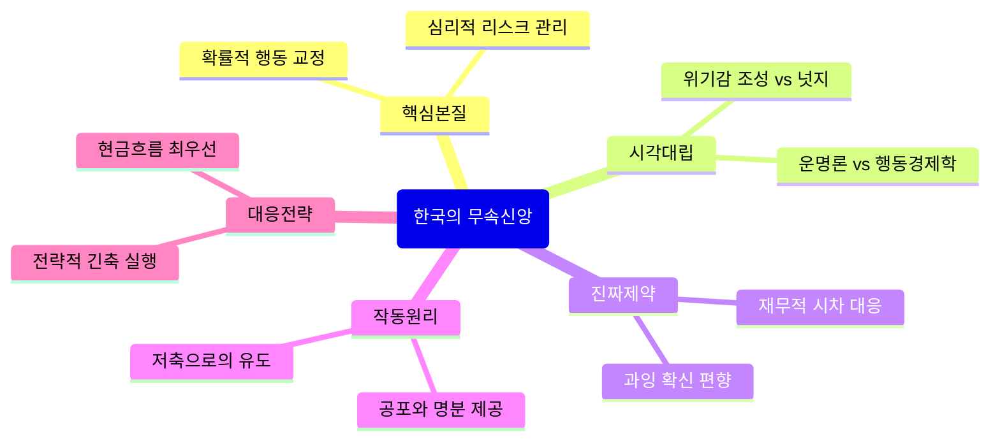

# [GENERAL_KNOWLEDGE] 한국의 무속신앙: 다각도 교차 검증 & 제1원리 심층 리포트
> topic: "한국의 무속신앙" | domain: "GENERAL_KNOWLEDGE" | sources_count: 1 | mode: "Autonomous Multi-Perspective Synthesis"

## 0. Executive Core Insight (다각도 종합 핵심 통찰)
한국의 현대 무속신앙은 초자연적 예언보다는 **'심리적 리스크 관리 시스템'**이자 **'확률적 행동 교정 도구'**로 작동한다. 이는 운세라는 피드백 루프를 통해 개인의 잉여 자산이 비합리적 소비(사치)로 흐르는 것을 방지하고, 향후 다가올 경제적 변동성(2027년)에 대비케 하는 행동 경제학적 메커니즘을 내포하고 있다.

## 1. Clash of Perspectives (쏟아지는 다양한 시각의 대립과 모순)
- **주류 무속적 시각**: 특정 띠에 부여된 운명론적 대박/쪽박 시나리오를 강조하며, 이를 개인의 도덕적 결단과 운명적 기운의 조화로 해석함.
- **현장 분석적 시각**: 운세 콘텐츠를 '심리적 제동 장치'로 활용함. 잘나갈 때 자제력을 잃는 인간의 본성을 억제하기 위해 '사치'라는 키워드를 경고의 레버리지로 사용.
- **비판적 시각 (팩트 기반)**: 띠별 운세는 일반화의 오류에 불과하며, 실제 경제적 결과는 시장 상황과 자산 관리 능력에 기인함. 그러나 이러한 메시지가 대중의 '손실 회피 편향'을 자극하여 불필요한 과소비를 막는 '넛지(Nudge)' 효과를 낸다는 점은 인정함.

## 2. Real Constraints vs Fake Constraints (진짜 제약 vs 가짜 제약 해체)
- **[가짜 제약]**: "특정 띠라서 돈이 나간다"는 운명론. 띠 자체에 물리적 에너지나 재무적 인과관계는 존재하지 않음.
- **[진짜 제약]**: 
    - **시간적 지연(Time-lag)**: 2026년의 수익이 2027년의 고정 지출이나 소득 감소를 방어할 자본으로 기능해야 한다는 경제적 실체.
    - **인지적 편향**: 성공 경험 시 발생하는 '과잉 확신 편향(Overconfidence Bias)'. 통이 커지고 사치가 늘어나는 것은 운명이 아니라 생물학적 보상 체계의 함정임.

## 3. Underlying Mechanics & Feedback Loops (기저 인과관계 및 작동 메커니즘)
이 구조는 **[운세 공포(위기감 조장) → 행동 수정 → 자산 비축]**의 피드백 루프를 형성한다.
1. **입력(Input)**: "대박이지만 사치하면 쪽박"이라는 메시지 입력.
2. **처리(Processing)**: 대중은 자신의 성공(대박)을 확인받고 싶은 심리와 실패(쪽박)를 피하고 싶은 본능이 충돌함.
3. **출력(Output)**: 실제 자산 관리 시 '저축'을 선택함으로써 2027년의 리스크를 헤징(Hedging)함.
무속은 여기서 사실 여부를 떠나 **'개인이 자신의 재무적 절제를 정당화하는 심리적 명분'**을 제공하는 기제로 작동한다.

## 4. Second & Third-Order Ramifications (2차·3차 파급효과 시나리오)
- **3개월 후**: 2026년 중반, 해당 메시지를 수용한 이들은 소비 패턴이 위축되어 실질 현금 보유량이 소폭 증가함.
- **6개월 후**: 2026년 하반기, 무속 메시지가 '예언'이 아닌 '경고'로 소비되어 연말 소비 시장의 소규모 위축(디플레이션 압력) 혹은 개인 자산 건전성 강화로 나타남.
- **장기적 결과**: 2027년 경제적 환경 변화 시, 미리 비축한 자금이 완충재가 되어 '쪽박을 면했다'는 인과관계가 사후적으로 확립됨(확증 편향의 완성).

## 5. 10x Actionable Playbook (실전 대응 전략)
1. **외부 메신저 거세**: '띠'라는 변수를 제거하고, 현재 자신의 '현금 흐름(Cash flow)' 상태만 객관적 데이터로 치환하여 볼 것.
2. **심리적 방어막 활용**: 무속인의 경고를 '나를 향한 조언'으로 받아들여 '사치품 소비 목록'을 작성하고, 이를 50% 감축하는 전략적 긴축(Lean Strategy)을 수행할 것.
3. **확률적 사고 도입**: 2027년의 불확실성을 '운'이 아닌 '경기 사이클'로 인식하고, 2026년에 벌어들인 잉여 소득을 즉각 안전 자산(예금, 채권 등)으로 이동시켜 **유동성을 고정**할 것.

## 6. Structural Mindmap (통합 구조도)
