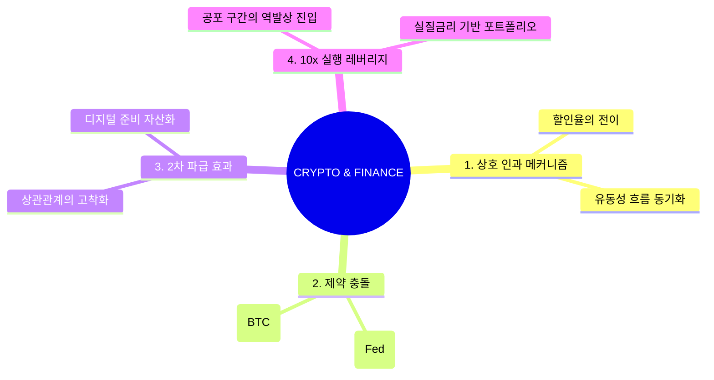

# [METASYNTHESIS] 자본 비용의 붕괴와 비트코인 네트워크: 거시적 인과 구조 리포트

## 0. Executive Core Insight (융합 핵심 통찰)
**"비트코인은 중앙은행의 금리 결정(자본 비용)을 '수학적 상수(공급 제한)'로 대체하려는 인류 최초의 거시 경제적 반란이다."**
금리 인하는 법정화폐의 가치 희석을 의미하며, 이는 시스템적 신뢰의 약화로 이어집니다. 두 시스템이 만나는 지점에서 비트코인은 단순한 자산이 아니라, **'연준의 통화 정책 실패를 헤지하는 수학적 안전 자산'**이라는 거대한 역학 관계가 완성됩니다.

---

## 1. Interconnected Mechanics (상호 인과 메커니즘)
*   **할인율의 전이 (Discount Rate Transfer):** 미국의 기준금리는 글로벌 자본의 '기준 할인율'입니다. 금리 인하는 비트코인 자산 가치를 평가하는 분모(할인율)를 낮춤과 동시에, 법정화폐의 구매력 하락이라는 분자(실질 가치)의 위기를 가속화합니다. 
*   **역방향 피드백 루프:** 
    *   [금리 인하] → [달러 유동성 증가] → [비트코인 매수 유입] → [기관 자본의 ETF 편입] → [중앙화된 게이트웨이(거래소)의 금융화] → [비트코인의 제도권 자산화].
    *   이 과정에서 비트코인은 중앙은행의 정책 레버리지 영향권 안으로 더 깊숙이 들어오며, 금리 민감도가 과거의 독립적 자산에서 '기술주(Tech Stock) 이상의 고감도 지표'로 변모합니다.

---

## 2. Clash of Constraints: Real vs Fake (제약의 충돌)
*   **진짜 제약 (Hard Constraints):** 
    *   **비트코인:** 2,100만 개의 수학적 상한선(공급 비탄력성). 
    *   **미국 금리:** 부채의 경직성(국가 부채 이자 지불 능력의 한계).
    *   *충돌 지점:* 미국이 부채를 갚기 위해 금리를 내릴 수밖에 없는 물리적 한계에 봉착할 때, 비트코인의 희소성은 법정화폐의 팽창 속도를 압도하며 '가치 저장 수단'으로서의 본질이 정점에 도달합니다.
*   **가짜 제약 (False Constraints):**
    *   "금리 인하 뉴스에 따른 즉각적인 급등"에 대한 맹신. 시장은 이를 호재로 보지만, 경제 시스템의 체력이 소진된 상황에서의 금리 인하는 '침체의 신호탄'으로서 비트코인의 단기 매도 압력을 유발하는 역설을 낳습니다.

---

## 3. Second-Order & Third-Order Systemic Effects
*   **2차 효과:** 기관 자산 배분 비중이 임계치를 넘으면서, 비트코인 가격이 미국의 고용 지표와 완벽하게 동기화되는 '디지털 상관관계의 고착화' 현상이 발생합니다.
*   **3차 효과 (역사적 변곡점):** 법정화폐 시스템의 '금리 조절' 기능이 더 이상 인플레이션을 제어하지 못하는 시점(Stagflationary Collapse), 비트코인이 전 세계 중앙은행의 '디지털 준비 자산(Reserve Asset)'으로 편입되는 'Systemic Pivot'이 발생할 확률이 높습니다. 이는 자본주의 역사상 가장 큰 가치 이동입니다.

---

## 4. Unified 10x Strategic Playbook (통합 10배 실행 레버리지)
*   **침체형 금리 인하 활용:** 경기 침체로 인한 급격한 금리 인하는 비트코인에 '공포 매도'를 유발합니다. 이는 저점 매수(Buy the Dip)의 기회입니다. 즉, **"경제 뉴스는 공포를 만들고, 수학적 비트코인은 가치를 보존한다"**는 원칙을 고수하십시오.
*   **실질 금리 기반 포트폴리오:** (기준금리 - CPI)를 1차 지표로 삼고, 온체인상의 '순 실현 가치'가 하락할 때 비트코인 현물을 적립하십시오. 선물 레버리지는 '금융 노이즈'이므로 제거하고, 하드웨어 지갑을 통한 '자산의 주권'을 강화하는 것이 10배 이상의 비대칭 수익을 만드는 전략입니다.

---

## 5. Visual Mindmap & Structural Hierarchy

### (A) XMind / Outliner Compatible Tree
- CRYPTO & CRYPTO 융합 (금리 x 비트코인)
	- 1. 상호 인과 메커니즘
		- 할인율 변화에 따른 비트코인 가치 재평가
		- 달러 유동성 공급과 ETF 자본 흐름의 연결
	- 2. 제약 충돌 및 트레이드오프
		- 수학적 희소성 vs 국가 부채의 구조적 경직성
		- '경기 침체' 신호와 '유동성 공급' 간의 역설적 병목
	- 3. 2차 파급 효과 & 시나리오
		- 고용 지표와 비트코인 가격의 완벽 동기화
		- 디지털 준비 자산으로의 거시적 패러다임 전환
	- 4. 통합 10x 실행 레버리지
		- 공포 구간에서의 '수학적 가치' 역발상 매수
		- 자산 주권(콜드 월렛) 강화를 통한 시스템 리스크 회피

### (B) Mermaid Mindmap Code Block
