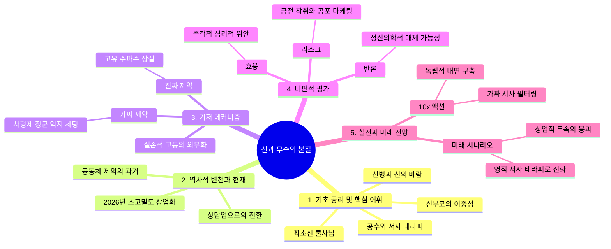

# [신과 무속의 본질] 전방위 제1원리 지식 마스터 리포트

---

## 0. Executive Core Insight (본질 관통 핵심 요약)
> **"무속(Shamanism)의 본질은 초월적 존재의 강림 그 자체가 아니라, 개인이 겪는 극단적 실존적 위기(신병·무병)를 문화적 메커니즘과 서사적 언어(신명·공수)로 번역하여 생존의 궤도에 안착시키는 '인간 중심의 주체성 재구성 시스템'이다."**

---

## 1. Ground Zero: Foundational Axioms & Key Lexicon (기초, 기반, 핵심 어휘 사전)

### 💡 입문자를 위한 일상 비유
무속에서 신을 모시는 과정을 스마트폰에 비유할 수 있습니다. 스마트폰(제자/무당)을 공장에서 막 꺼내어 개통할 때, 통신사 네트워크(천신·조상신)와 연결되는 최초의 인증 절차가 필요합니다. 그런데 사기꾼 대리점 주인이 임의로 이상한 요금제와 불필요한 부가서비스(정체 불명의 가짜 신, 사형제 장군 등)를 억지로 끼워 팔며 폭리(굿값, 과도한 비용)를 취하는 현상이 오늘날 무속 판의 고질병입니다. 진짜 내 스마트폰과 맞는 주파수(최초의 신, 불사님)를 찾는 것이 이 리포트의 목적입니다.

### 🔑 핵심 필수 키워드 3~5개 정의
1. **최초신 (불사님 / 주신)**
   - **정의 및 역할:** 무당을 세상에 태어나게(문이 열리게) 만든 가장 근본적인 뿌리 조상 및 천신. 점사의 적중률과 영적 직관의 베이스를 담당하는 핵심 주파수.
2. **신병 (무병 / 신의 바람)**
   - **정의 및 역할:** 현대 의학으로 치유되지 않는 신체적·정신적 고통. 사회적 시스템에서 탈락한 개인이 영적 서사(Narrative)를 통해 고통의 의미를 재부여받는 문턱(Threshold).
3. **신부모 (신엄마·신아버지)**
   - **정의 및 역할:** 입문자를 무당의 길로 이끄는 스승. 그러나 제자의 고유한 주파수를 무시하고 상업적 목적(금전 착취)으로 '만능형 가짜 신'을 주입하는 구조적 리스크의 진원지.
4. **공수 (메시지 / 서사)**
   - **정의 및 역할:** 무당이 신령의 이름으로 내뱉는 언어적 표현. 이는 절대적 예언이라기보다, 내담자의 고통을 해석하고 치유하는 심리·문화적 내러티브 테라피.

---

## 2. Historical Trajectory & Paradigm Shifts (역사적 배경, 변천 궤적, 현재 위치)

- **과거의 출현 배경 (전통 사회):** 무속은 마을의 안녕과 공동체의 트라우마를 치유하던 집단적 내러티브 기술이었습니다. 물리적 이동이 제한되던 시절, 무당의 고행과 기도는 공동체 내부의 정서적 균형을 맞추는 중대한 사회적 자본이었습니다.
- **패러다임 전환 궤적 (현대화 과정):** 산업화와 도시화 속에서 무속은 집단적 제의에서 파편화된 '개인 맞춤형 영적 상담업'으로 변모했습니다. 정보의 비대칭성과 자본주의의 침투로 인해, 신령의 영성이 아닌 '상업적 컨설팅과 굿판 영업'이 주도권을 잡게 되었습니다.
- **현재 시점의 구조적 좌표 (2026년 현재):** 정보 과잉과 SNS의 발달로 "너도 나도 무당"인 초고밀도 경쟁 시장이 되었습니다. 신당의 본질(내면적 치유와 주체적 서사)은 퇴색하고, 무속인 양성 학원, 과도한 굿판 마케팅, 조상 족보 짜깁기를 통한 '가짜 신 대량 생산 시스템'이 작동하는 구조적 위기 국면입니다.

---

## 3. First Principles & Structural Mechanism (기저 메커니즘과 진짜 제약)

### 물리·논리적 인과관계 본질
1. **주체성의 분리 (Identity Separation):** 인간의 뇌는 극한의 스트레스(무병) 상황에서 자아를 보호하기 위해 '초월적 타자(신령)'라는 가상의 인격을 외부화합니다. 이때 무당은 이 외부화된 인격을 매개로 타인의 고통을 거울처럼 비추어 해석하는 상담자 역할을 수행합니다.
2. **서사의 일관성 (Narrative Consistency):** 나무의 뿌리가 튼튼해야 과실이 열리듯, 제자 개인의 '최초신(불사님)'이라는 단 하나의 명확한 축이 서 있어야 점사가 흔들리지 않습니다. 여기에 '장군, 대감, 동자'라는 수십 가지 서브 캐릭터를 무분별하게 추가하는 것은 시스템의 메모리(정신)를 과부하시키는 에러(Error)입니다.

### 진짜 제약 vs 가짜 제약 해체
- **가짜 제약:** "신엄마가 지정해 준 조상 족보와 사형제 장군(작두, 별상, 사신, 구홍)을 다 모셔야 진정한 무당이 된다." $\rightarrow$ **해체:** 이는 신부모가 굿을 더 자주, 크게 유도하여 금전을 갈취하기 위한 인위적 제약에 불과합니다.
- **진짜 제약:** "제자 본인이 자신의 내면을 울리는 최초의 신호(불사님/주신)를 인지하지 못하고, 남의 흉내만 낼 때 점사는 무너지고 영적 고립은 심화된다."

---

## 4. Critical Dialectics: Pros, Cons & Counter-arguments (비판적 사고: 명과 암, 맹점과 반론)

- **핵심 효용 (Pros):** 무속은 제도권 심리 치료가 닿지 않는 극단적 소외 계층에게 즉각적인 위안과 서사적 해방감을 제공합니다. 내담자와 무당 모두에게 '고통의 시크릿 코드'를 해석할 언어를 제공한다는 점에서 강력한 정서적 레버리지를 가집니다.
- **구조적 취약점 (Cons):** 신부모-애동제자 간의 권력 비대칭성이 극단적 착취 구조로 이어집니다. 공포 마케팅(니가 죽는다, 집안이 망한다)을 통해 금전적 자원을 강탈하고, 제자를 독립된 주체가 아닌 '종속된 영업 사원'으로 소모합니다.
- **유효한 반론 (Counter-arguments):** "신 내림과 무속은 철저한 사기이자 미신이며, 현대 정신의학적 치료로 대체되어야 한다"는 환원주의적 비판이 존재합니다. 그러나 제1원리적 관점에서 볼 때, 인간이 겪는 실존적 공포는순수 과학적 처방만으로는 해소되지 않는 의미의 공백(Meaning Void)을 가지며, 무속은 바로 이 공백을 메우는 고대의 문화적 알고리즘으로 여전히 기능합니다.

---

## 5. Master Playbook: Real-world Applications & Future Scenarios (실전 활용과 미래 전망)

### 현업 10배 레버리지 실행 규율
1. **오염된 서사 필터링 (De-contamination):** 타인(신부모)이 주입한 수십 개의 가짜 신(사형제 장군, 억지 조상 족보)을 리셋하고, 나를 움직이는 단 하나의 핵심 직관(최초신/불사님)만 남겨라.
2. **독립적 주체성 확립:** 신당에 예속되지 말고, 자신의 내면과 정직하게 대화하는 루틴(기도의 본질화)을 구축하여 상업적 굿판 의존도를 1/10로 축소하라.

### 2차·3차 파급 효과와 변곡점 시나리오
- **변곡점 2028년:** 무속 유튜브 및 SNS 채널의 범람으로 소비자들이 '가짜 신 내림 상업주의'를 학습하고 각성하기 시작하면서, 무분별한 굿판 영업 중심의 무속 생태계는 대중적 신뢰를 상실하고 붕괴할 것입니다.
- **미래 전망:** 향후 살아남는 무속은 화려한 굿판이나 위협적 공수가 아니라, 현대인의 고립과 트라우마를 치유하는 **'영적 상담 및 서사 테라피(Narrative Therapy) 브랜드'** 형태로 진화할 것입니다.

---

## 6. Visual Mindmap & Structural Hierarchy (시각화 구조)

### (A) XMind / Outliner Compatible Tree (순수 탭 들여쓰기 구조)
- 신과 무속의 본질
	- 1. 기초 공리 및 핵심 개념
		- 스마트폰 개통 비유 (최초 인증의 중요성)
		- 최초신 (불사님 / 주신)
		- 신병과 신의 바람
		- 신부모의 역할과 구조적 왜곡
	- 2. 역사적 변천과 현재 위치
		- 전통 사회의 공동체적 치유 테크놀로지
		- 산업화 이후 개인 맞춤형 상담업으로의 변모
		- 2026년 초고밀도 경쟁 시장과 상업화의 절정
	- 3. 기저 메커니즘 & 진짜 제약
		- 실존적 위기의 타자화 (외부화된 인격 메커니즘)
		- 가짜 제약: 억지 조상 족보와 사형제 장군 세팅
		- 진짜 제약: 내면적 주파수(최초신)의 상실과 혼란
	- 4. 비판적 평가 (Pros & Cons)
		- 장점: 극단적 소외 계층을 위한 강력한 서사적 치유
		- 리스크: 권력 비대칭을 이용한 금전적 착취와 공포 마케팅
		- 반론: 현대 정신의학과의 충돌 및 환원주의적 시각
	- 5. 실전 실행 및 미래 전망
		- 10x 레버리지: 타인의 서사 필터링 및 독립적 주체성 구축
		- 변곡점: 상업적 무속의 대중적 신뢰 붕괴 (2028년 시나리오)
		- 미래: 영적 상담 및 서사 테라피로의 진화

### (B) Mermaid Mindmap Code Block
