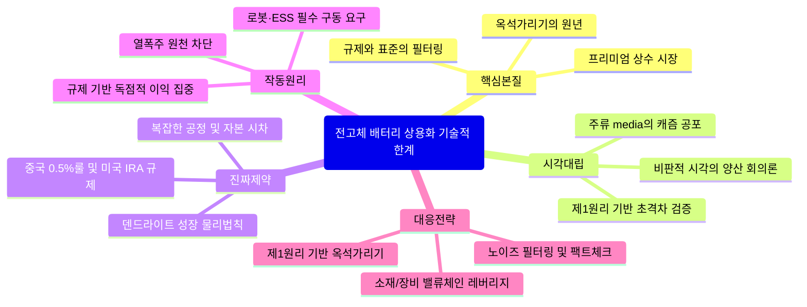

# [TECH_SCIENCE_AI] 전고체 배터리 상용화 기술적 한계: 다각도 교차 검증 & 제1원리 심층 리포트
> topic: "전고체 배터리 상용화 기술적 한계" | domain: "TECH_SCIENCE_AI" | sources_count: 3 | mode: "Autonomous Multi-Perspective Synthesis"

## 0. Executive Core Insight (다각도 종합 핵심 통찰)
2026년 전고체 배터리(ASB) 시장은 기술의 허황된 환상과 대중적 공포(캐즘·보조금 폐지 악재)를 벗어 던지고, 국가 주도의 표준화(중국 GB 0.5% 룰)와 공급망 재편(미국 IRA·FOC)이라는 거대한 물리적·제도적 필터를 통과하는 **'진짜 기술 해자 검증의 원년'**에 진입했습니다. 전고체 배터리는 대중적 범용 EV 시장의 가격 경쟁이 아니라, AI 데이터 센터 ESS, 휴머노이드 로봇(예: 아틀라스), 럭셔리 슈퍼카를 겨냥한 **'프리미엄 상수(Constant) 시장'**에서 본질적 가치를 입증하며 본격적인 산업 재편을 시작했습니다.

---

## 1. Clash of Perspectives (쏟아지는 다양한 시각의 대립과 모순)

| 구분 | 주류 해석 (대중 매체 및 일반 투자 시장) | 비판적 시각 (기술 및 현장 분석가) | 제1원리 기반 교차 검증 (실제 팩트) |
| :--- | :--- | :--- | :--- |
| **시장 상태** | 전기차 보조금 폐지와 캐즘으로 인한 2차전지 산업의 '악몽' 및 수요 침체 | 로봇 및 AI 데이터 센터 등 변수 투성이의 테마성 기대감에 불과 | 리튬이온의 가격 하락(KW당 $80)과 전고체의 프리미엄 가치가 분리되는 **'초격차 구간'** 진입 |
| **기술 신뢰도** | 2020년대 초중반 상용화 선언은 이미 수차례 지연된 '희망 고문' | 마케팅용 명목상 전고체와 덴드라이트, 공정 난제로 인한 양산 불확실성 상존 | 중국의 **'전량 손실 0.5% 이하 룰'** 같은 강제적 표준 규격이 가짜 반고체를 걸러내는 실질적 필터로 작동 |
| **투자/산업 전략** | 단기 시황 악화에 따른 회피 및 테마주 쏠림 현상 | 검증되지 않은 스타트업(예: 도넛랩 등)의 과장 광고에 대한 경계 필요 | 삼성 SDI, 에코프로비엠 등 명확한 파일럿 라인과 공급망(황화물계 등)을 가진 기업 중심의 옥석 가리기 |

---

## 2. Real Constraints vs Fake Constraints (진짜 제약 vs 가짜 제약 해체)

### [가짜 제약]: 대중의 공포, 관습적 선례, 검증되지 않은 소문, 제도적 착시
- **전기차 보조금 폐지 및 캐즘에 따른 산업 종말론**: 이미 2025년 하반기~2026년 초 시장에 완전히 선반영된 단기적 악재로, 배터리 본질의 성능 격차와는 무관함.
- **"전고체는 아직 먼 미래의 꿈이다"라는 막연한 회의론**: 이미 글로벌 선도 기업들이 파일럿 라인 가동을 넘어 완성차 실증(BMW, 벤츠 등) 단계에 진입했음에도 초기 몇 차례의 일정 지연만을 근거로 기술 전체를 부정하는 시각.
- **로봇/AI 기기의 단기적 작동 오류(예: 로봇의 보행 미숙)**: 로봇의 기계적 움직임 한계를 배터리 자체의 치명적 기술 제약으로 오인하는 시각.

### [진짜 제약]: 물리적 한계, 수학적 필연성, 자본 이동의 시차(Time-lag), 규제 및 원가 구조
- **덴드라이트(Dendrite) 성장 문제**: 고체 전해질 내부에서 리튬 금속 결정이 자라나 단락(Short Circuit)을 일으키는 물리적·화학적 필연성.
- **복잡한 고체 전해질 제조 공정 및 공급망 한계**: 황화물계($Li_2S$) 등 핵심 소재의 대량 합성 및 공정 안정성 확보를 위한 자본 및 시간적 시차.
- **국가 표준 및 지정학적 규제 장벽**: 중국의 '0.5% 이하 룰' 및 미국의 IRA·FOC 규제를 충족하지 못할 경우, 기술력과 무관하게 글로벌 공급망에서 원천 배제되는 구조적 원가 및 규제 제약.

---

## 3. Underlying Mechanics & Feedback Loops (기저 인과관계 및 작동 메커니즘)

```
[인과 피드백 루프 구조]
1. AI 데이터 센터 전력 대란 & 휴머노이드 로봇 상용화 니즈 폭발
   ↓
2. 기존 리튬이온의 열폭주(Thermal Runaway) 위험 및 낮은 에너지 밀도 한계 직면
   ↓
3. 고안전성·고밀도 특성을 지닌 '전고체 배터리(ASB)' 수요의 구조적 상수화
   ↓
4. 중국 GB 0.5% 룰 및 미국 IRA/FOC 등 강력한 규제 필터 가동
   ↓
5. 어설픈 마케팅 기업(가짜 반고체) 퇴출 & 기술 해자를 증명한 소수 플레이어(삼성 SDI, 에코프로비엠 등)로의 독점적 이익 집중
```

- **작동 원리**: 전고체 배터리는 액체 전해질을 완전히 배제함으로써 열폭주 원인을 원천 차단합니다. 이 물리적 특성은 전력 소모가 극심한 AI 데이터 센터용 ESS와 소형 고출력이 필수적인 휴머노이드 로봇 시장에서 **'선택이 아닌 생존 조건'**으로 작용합니다. 규제 장벽(중국 표준 + 미국 IRA)은 기술적 허세를 부리는 기업들을 도태시키고, 검증된 파일럿 라인과 공급망을 보유한 한국·일본의 핵심 플레이어들에게 독점적 시장 지위를 부여하는 피드백 루프를 완성합니다.

---

## 4. Second & Third-Order Ramifications (2차·3차 파급효과 시나리오)

- **3개월 이내 (단기)**: 
  - 중국의 GB 표준 초안 공식 발표에 따른 저가 반고체 마케팅 기업들의 주가 급락 및 구조조정 시작.
  - 리튬이온 배터리 가격 하락($80/kWh)과 맞물려 범용 EV와 프리미엄 ASB 시장의 투트랙 포지셔닝 확정.
- **6개월 이내 (중기)**: 
  - 북미 및 유럽 내 탈중국(FOC 규정 대응) 공급망을 확보한 한국 소재 기업(에코프로비엠, 롯데에너지머티리얼즈 등)으로의 글로벌 완성차 러브콜 집중.
  - 휴머노이드 로봇 및 AI 데이터 센터 ESS 실증 사업에 전고체 배터리 탑재 모델이 공식 채택되며 '테마주'에서 '실적 기반 성장주'로의 밸류에이션 리레이팅 발생.

---

## 5. 10x Actionable Playbook (실전 대응 전략)

1. **노이즈 필터링**: 전기차 캐즘이나 보조금 폐지 관련 자극적 언론 보도에 흔들리지 말고, 규제와 기술 표준 통과 여부에 집중할 것.
2. **규제 부합성 검증**: 투자 대상 기업이 중국의 '0.5% 룰' 및 미국의 IRA/FOC 규제 요건을 완벽히 충족하는지 팩트체크할 것.
3. **파일럿 라인 검증**: 실험실 수준의 개발 발표에 현혹되지 말고, 실제 양산용 파일럿 라인을 구축하고 완성차 실증(BMW, 벤츠 등) 레코드가 있는 기업만 선별할 것.
4. **소재 생태계 밸류체인 공략**: 완제품 대기업(삼성 SDI 등)뿐만 아니라 핵심 고체 전해질 및 원료 공급망을 장악한 상류 소재(에코프로비엠 등) 레버리지를 확보할 것.
5. **AI·로봇 섹터와의 융합 시각 유지**: 2차전지를 단순히 전기차 부품으로만 보지 말고, AI 데이터 센터 ESS와 휴머노이드 로봇의 필수 구동 부품으로 재정의하여 접근할 것.
6. **가짜 스타트업 회피**: 명확한 팩트나 실증 없이 '전고체' 명목으로 투자금을 유치하는 실체 없는 테마형 기업은 철저히 배제할 것.
7. **가격 프리미엄 전략 이해**: LFP/NCM의 범용 가격 경쟁(하락세)과 ASB의 고가 프리미엄(상승세) 시장의 분화 구조에 맞춰 포트폴리오를 이원화할 것.
8. **글로벌 공급망 다변화 체크**: 탈중국 공급망(황화 리튬 등) 구축 단계에서 실질적 수혜를 입는 장비 및 소재 업체를 추적할 것.
9. **시간차(Time-lag) 매매법 적용**: 악재가 이미 주가에 반영된 구간을 저점 매집의 기회로 활용하되, 가치 실현 시기(2026년 원년 이후)에 발맞춘 호흡을 유지할 것.
10. **제1원리 중심의 모니터링**: 마케팅 용어(반고체, 차세대 등)에 현혹되지 말고, 덴드라이트 극복 및 수분/불순물 손실률 등 물리적 실체만으로 기술력을 평가할 것.

---

## 6. Structural Mindmap (통합 구조도)
